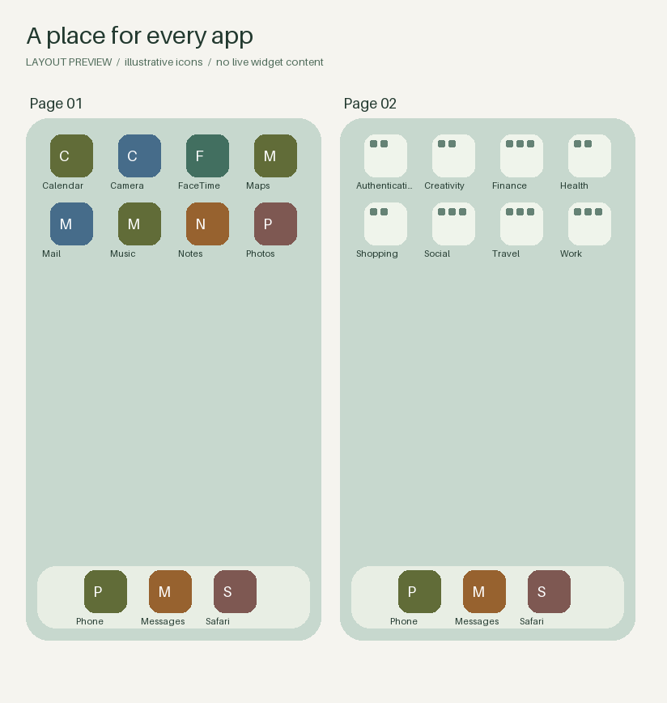

# iOS Organizer

[](https://github.com/AevarOfjord/IOS-Organizer/actions/workflows/checks.yml)
[](LICENSE)

**Organize your iPhone by talking to your coding agent. See the layout before you apply it.**

Use Codex, Claude Code, or Gemini CLI to list your apps, choose folder groups, and tidy your Home Screen. The agent handles the commands. You describe what you want in everyday language.



*Generated from [fictional example data](examples/layout.yaml). Icons use initials. This is a layout preview, not an iPhone screenshot.*

## Get started

You need a **Mac**, **Python 3.11+**, a data-capable **USB cable**, and a coding agent that can run commands locally on that Mac. Your agent's account or subscription is separate. Standard use requires **no Developer Mode**, jailbreak, or AI API key.

1. [Download the project](https://github.com/AevarOfjord/IOS-Organizer/archive/refs/heads/main.zip) and unzip it, or clone this repository.
2. Open that project folder in Codex, Claude Code, or Gemini CLI on your Mac. A web-only chat cannot access a locally connected phone by itself.
3. Paste this message:

> Read the project instructions and help me organize my iPhone. I'm new to coding agents, so guide me through each step and handle setup and commands for me. First help me connect my phone and show a complete list of its apps, including folders and App Library-only apps. Then ask what I want to change and what must stay in place. After I answer, prepare a layout, show me an image preview and the full folder list, and wait for my approval before applying it.

The agent will guide you through connecting and unlocking your phone and accepting **Trust This Computer** if it appears. You handle passcodes and permission prompts yourself. It saves your current layout before planning changes.

## What happens next

1. **See your apps.** Get the full user-facing app inventory: dock, pages, folders, and App Library-only apps, including offloaded placeholders. Widgets and additional icons are listed separately.
2. **Choose what to change.** The agent asks one or two questions at a time. Tell it what must stay in place, how to group apps, and how to order your pages. You can ask for a recommendation.
3. **Review the layout.** See a PNG image, an HTML preview with folder contents, and a Markdown app list. Refine them in plain language.
4. **Approve and apply.** Once you approve the reviewed proposal, the CLI takes another backup, validates against the phone, writes the layout, and reads it back to verify it.

For example: “Keep my main page and the bottom row unchanged. Group everything else by function, add a folder for work, and sort the folders alphabetically.”

## What works today

This is an **early release**, developed and exercised on one device/iOS configuration. The offline tests cover compiler behavior, validation, previews, recovery paths, and mocked device operations; they do not establish compatibility with every iPhone.

| Capability | Current status |
| --- | --- |
| USB app inventory, layout backup, and restore | Implemented; real-device workflow exercised |
| App/folder ordering and multi-page folders | Implemented; fresh backup and readback verification |
| Preserve existing widget, Smart Stack, web clip, and app-bookmark payloads | Compiler preserves opaque data; visual details still need inspection |
| Offline validation, folder lists, HTML and PNG previews | Implemented; no phone required |
| Designs with empty cells and new widgets | Validated spatial plans and previews |
| Apply exact spacing or add/configure widgets | Requires the agent's approved iPhone Mirroring tools, or guided manual steps; complete automatic workflow **not yet verified** |
| App Library-only placement after a USB write | Limited: iOS may bring omitted apps onto Home Screen pages |

The CLI does not control iPhone Mirroring itself. Mirroring depends on compatible devices, region, and agent permissions. If it is unavailable, the agent explains the remaining manual steps. The separate experimental CoreDevice backend requires explicit opt-in and Developer Mode; it is outside standard setup.

[Widget and spacing workflow](docs/native-ui.md) · [Fictional widget preview](docs/assets/widget-preview.png) · [Compatibility observations](docs/schema_notes.md)

## Try it without a phone

Ask your agent to preview the fictional examples, or run:

```bash
python3 -m venv .venv
.venv/bin/python -m pip install -e '.[dev]'
.venv/bin/python -m ios_organizer guide
.venv/bin/python -m ios_organizer validate --layout examples/layout.yaml
.venv/bin/python -m ios_organizer preview --layout examples/layout.yaml --output workspace/example.html --open
.venv/bin/python -m ios_organizer preview --layout examples/layout.yaml --output workspace/example.png
.venv/bin/python -m ios_organizer inventory --layout examples/layout.yaml
```

These commands are offline. Example files are for demonstrations; prepare a fresh device-based proposal before applying a layout.

## Consistent guidance across agents

[AGENTS.md](AGENTS.md) is the shared entry point. [CLAUDE.md](CLAUDE.md) and [GEMINI.md](GEMINI.md) import it. The [agent workflow](docs/agent-workflow.md) defines the opening, inventory, questions, preview, approval, and verification. `ios-organizer guide --stage preferences` returns the same versioned questions and completion criteria for any agent.

These files reduce differences in the process; models can still make different recommendations. The guide is a conversation contract, not a persistent approval system. The CLI validates data and confirms writes, while the agent must establish approval of the current preview. No live comparison across all three agents has been completed.

## Privacy and recovery

Backups, app inventories, layouts, and screen observations belong in the ignored `backups/`, `workspace/`, and `probe/` directories. They can contain personal information. The public examples and fixtures are synthetic. Your chosen agent may process app data under its own settings; this project has no AI service integration or telemetry.

A layout backup is **not a full iPhone backup**. It cannot guarantee restoration of App Library-only placement, free spacing, or widget configuration. Keep the recovery path reported by the CLI. A mismatch is reported as a mismatch, rather than silently marked successful. See [recovery commands](docs/cli-reference.md).

## Development and help

[CLI reference](docs/cli-reference.md) · [Contributing](CONTRIBUTING.md) · [Security](SECURITY.md) · [Changelog](CHANGELOG.md) · [Report a problem](https://github.com/AevarOfjord/IOS-Organizer/issues/new/choose)

```bash
.venv/bin/pytest -q
python3 scripts/check_release.py
```

Tests use synthetic fixtures and mocked devices. They do not modify a connected phone. Hardware testing is a separate, explicit activity. GPL-3.0-or-later; see [LICENSE](LICENSE) and [dependency acknowledgements](NOTICE).
